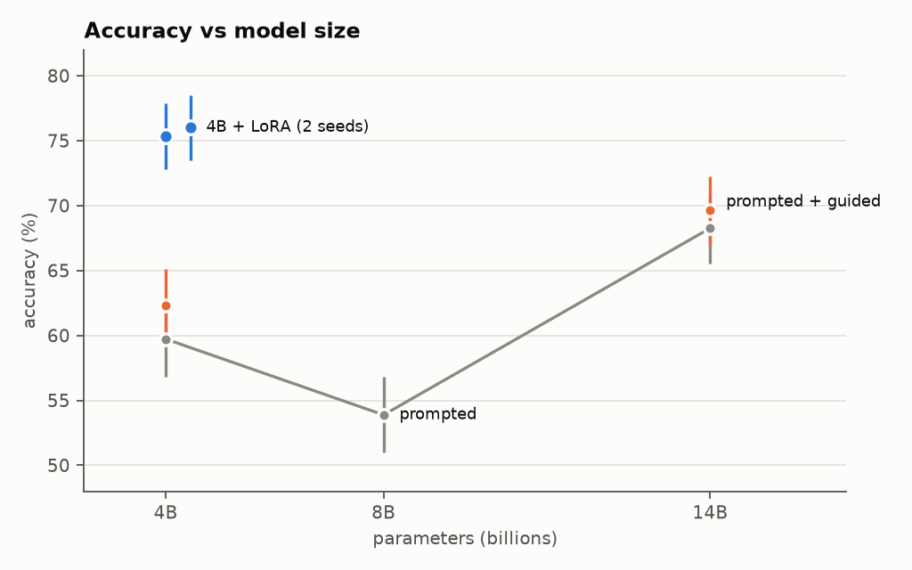
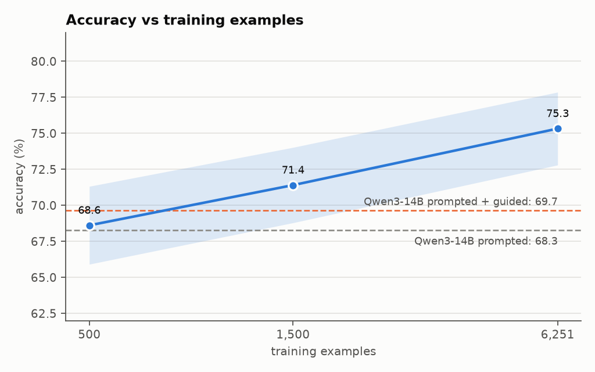

# finqa-lora

[](https://github.com/Tanatas298/finqa-lora/actions/workflows/ci.yml)
[](https://huggingface.co/Tanatas298/qwen3-4b-finqa-lora)

A small open model that answers numerical questions about company annual reports.

Qwen3-4B is fine-tuned with LoRA on [FinQA](https://github.com/czyssrs/FinQA) to read a report
page (text and a table) and write a short calculation program. Python executes the program, so
the arithmetic is exact and every answer can be traced step by step.

## Highlights

- **75.7% accuracy** on the FinQA test set, averaged over two training runs (75.3% and 76.0%).
- **Beats a model 3.5× larger:** +7 points over prompted Qwen3-14B, and +5.7 points even when
  the 14B model is forced to produce valid programs.
- **2.7× faster:** 0.40 s per answer vs 1.07 s for the 14B model, in 8 GB of weights.
- **Cheap to train:** 6,251 examples, under 2 hours on one 24 GB GPU.
- **Generalises:** same accuracy on annual reports (company and year) it never saw in training.

## Example

<!-- BEGIN example -->
> what was the percentage change in net earnings from continuing operations from 2014 to 2015?

|  | 2015 | 2014 |
|---|---|---|
| net earnings from continuing operations | 3538 | 3480 |

```text
Program: subtract(3538, 3480), divide(#0, 3480)
#0 = subtract(3538, 3480) = 58
#1 = divide(#0, 3480) = 0.01667
```
<!-- END example -->

## Results

FinQA test set, 1,147 questions, scored with FinQA's official evaluation script. Prompted
models get 4 similar solved examples in the prompt. *Guided decoding* restricts the output to
valid programs.

<!-- BEGIN results -->
| Model | Accuracy | Program match | Valid output | Latency | Size |
|---|---|---|---|---|---|
| Qwen3-4B, prompted | 59.7% | 54.8% | 89.4% | 0.59 s | 8 GB |
| Qwen3-4B, prompted + guided | 62.3% | 56.7% | 99.0% | 0.52 s | 8 GB |
| Qwen3-8B, prompted | 53.9% | 49.2% | 83.9% | 2.90 s | 16 GB |
| Qwen3-14B (4-bit), prompted | 68.3% | 63.1% | 93.6% | 1.07 s | 10 GB |
| Qwen3-14B (4-bit), prompted + guided | 69.7% | 64.3% | 99.5% | 0.98 s | 10 GB |
| **Qwen3-4B + LoRA, run 1** | **75.3%** | **71.0%** | **99.6%** | **0.40 s** | **8 GB** |
| **Qwen3-4B + LoRA, run 2** | **76.0%** | **71.6%** | **99.9%** | **0.41 s** | **8 GB** |
<!-- END results -->

- **Accuracy:** the executed program gives the correct answer.
- **Program match:** the program is equivalent to the reference program.
- **Valid output:** the output is a program that runs.

The fine-tuned model's lead over every baseline is statistically significant (p < 0.0001,
[details](docs/results.md#significance)).

### Two training runs

The final model was trained twice with different random seeds:

<!-- BEGIN runs -->
|  | Run 1 | Run 2 | Mean |
|---|---|---|---|
| Accuracy | 75.3% | 76.0% | 75.7% |
| Program match | 71.0% | 71.6% | 71.3% |
| Accuracy on reports unseen in training | 75.7% | 74.8% | 75.2% |
<!-- END runs -->

The model on the Hugging Face Hub is run 1, chosen because it scored higher on the validation
set (76.6% vs 75.9%).

### Training data size

<!-- BEGIN curve -->
| Training examples | 500 | 1,500 | 6,251 |
|---|---|---|---|
| Accuracy | 68.6% | 71.4% | 75.3% |
<!-- END curve -->

With 500 examples the model already matches prompted Qwen3-14B.

<p align="center">
  
  
</p>

### Published systems

Systems scored the same way, on executed programs:

| System | Model | Accuracy |
|---|---|---|
| FinQANet (Chen et al., 2021) | fine-tuned RoBERTa-large | 61.2% |
| APOLLO (Sun et al., 2024) | fine-tuned ensemble | 71.1% |
| FINDER (Khatuya et al., 2025) | GPT-4 pipeline | 75.3% |
| **This project** | **Qwen3-4B + LoRA** | **75.3–76.0%** |

## How it works

1. **Data:** each FinQA question comes with a report page and a gold program such as
   `subtract(3538, 3480), divide(#0, 3480)`. The model learns to write that program.
2. **Training:** LoRA (rank 16) on Qwen3-4B in bf16, 2 epochs, loss on the program only.
   Learning rate and number of epochs were chosen on the validation set.
3. **Inference:** vLLM generates the program; a Python interpreter executes it.
4. **Evaluation:** FinQA's official script compares the result with the gold answer. The test
   set was used only for the final numbers.

More detail: [`docs/results.md`](docs/results.md) (all results, confidence intervals, error
analysis) and [`docs/evaluation.md`](docs/evaluation.md) (how everything is measured).

## Quick start

Use the trained model from the Hub:
[`Tanatas298/qwen3-4b-finqa-lora`](https://huggingface.co/Tanatas298/qwen3-4b-finqa-lora)
(usage example in the model card).

Reproduce everything (Linux or WSL2; vLLM and Unsloth need separate environments):

```bash
python3 -m venv ~/venvs/vllm && ~/venvs/vllm/bin/pip install -r requirements.txt
python3 -m venv ~/venvs/train && ~/venvs/train/bin/pip install -r requirements-train.txt
export PYTHONPATH=src

~/venvs/vllm/bin/python scripts/prepare_data.py   # download FinQA
bash scripts/run_all.sh                            # train, evaluate, build tables
```

Rebuild all tables and charts from the stored predictions (no GPU):

```bash
pip install -r requirements-dev.txt && PYTHONPATH=src python scripts/make_tables.py
```

## Project structure

```text
src/finqa_ft/     interpreter, prompts, metrics, official FinQA scorer, guided-decoding grammar
scripts/          data preparation, training, evaluation, tables and charts, Hub upload
reports/          scored predictions, metrics, tables and charts
docs/             full results, evaluation method, model card
tests/            unit tests (no GPU needed): pytest && ruff check .
```

## License

Code: MIT. FinQA dataset: Chen et al., EMNLP 2021 (MIT / CC BY 4.0), not redistributed here.
Qwen3: Apache-2.0. See [`THIRD_PARTY_NOTICES.md`](THIRD_PARTY_NOTICES.md).
